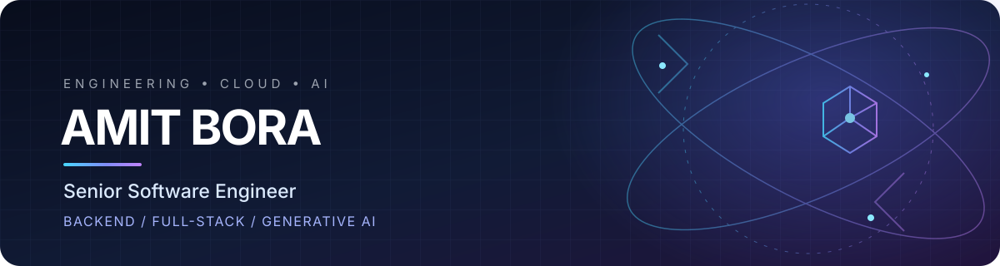

 

---

## About

I'm a **Senior Software Engineer with 7+ years of experience** building backend platforms, APIs, cloud applications and fintech integrations. I enjoy working across the stack—from data models and distributed workflows to intuitive user experiences—and I'm actively exploring practical applications of Generative AI.

- **Engineering:** Backend architecture, REST APIs, integrations, performance and reliability
- **Full-stack:** Python, PHP, Node.js, React and modern web application development
- **Cloud & data:** AWS, Azure, SQL Server, PostgreSQL, MongoDB and Redis
- **AI exploration:** LLM applications, RAG, vector search, agents and MCP

## Selected work

A few projects that represent the kind of systems I enjoy building.

<table>
  <tr>
    <td width="50%" valign="top">
      <h3><a href="https://github.com/amitbora007/p2p-file-transfer">P2P File Transfer</a></h3>
      
Browser-to-browser file transfer across different networks, built around WebRTC data channels, signaling and resilient chunked streaming.

      
WebRTC · React · Node.js · DataChannel

    </td>
    <td width="50%" valign="top">
      <h3><a href="https://github.com/amitbora007/vigilapi">VigilAPI</a></h3>
      
A serverless endpoint-monitoring platform with scheduled checks, PostgreSQL coordination, alerting and a responsive analytics dashboard.

      
React · Supabase · PostgreSQL · Edge Functions

    </td>
  </tr>
  <tr>
    <td width="50%" valign="top">
      <h3><a href="https://github.com/amitbora007/amit-portfolio">Personal Portfolio</a></h3>
      
A responsive engineering portfolio with interactive project case studies, an AI assistant and a serverless contact workflow.

      
React · Tailwind CSS · Framer Motion · Vercel

    </td>
    <td width="50%" valign="top">
      <h3><a href="https://github.com/amitbora007/testblind-ai">TestBlind AI</a></h3>
      
An AI-powered software testing platform combining mutation testing, LLM-generated regression tests, incident-to-test workflows and isolated code execution.

      
Python · FastAPI · React · TypeScript · PostgreSQL · Docker

    </td>
  </tr>
</table>

  <a href="https://amitbora.vercel.app/"><b>Explore all projects and case studies on my portfolio →</b></a>

## Technology toolkit

**Languages & backend**

**Frontend & application development**

**Data, cloud & engineering tools**

**AI & developer tooling**

  
  
  
  

## GitHub at a glance

  
  
   
  
   
  

## Contribution journey

  <picture>
    <source media="(prefers-color-scheme: dark)" srcset="https://raw.githubusercontent.com/amitbora007/amitbora007/output/github-contribution-grid-snake-dark.svg" />
    <source media="(prefers-color-scheme: light)" srcset="https://raw.githubusercontent.com/amitbora007/amitbora007/output/github-contribution-grid-snake.svg" />
    
  </picture>

The contribution animation is generated daily by GitHub Actions. It appears after the workflow runs successfully for the first time.

## Let's connect

I'm interested in thoughtful engineering conversations, backend and cloud architecture, developer tooling, and practical AI applications.

  
  
  

  Building dependable systems · Learning continuously · Exploring what's next

